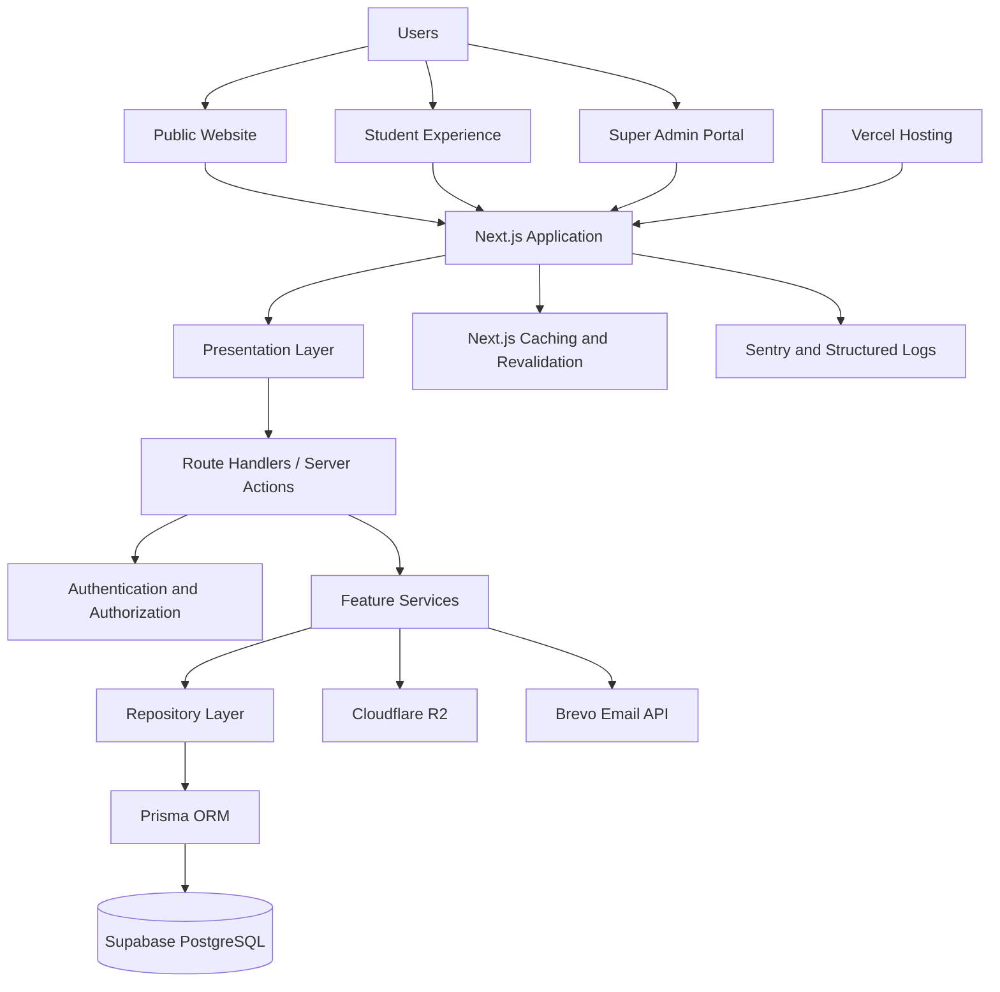
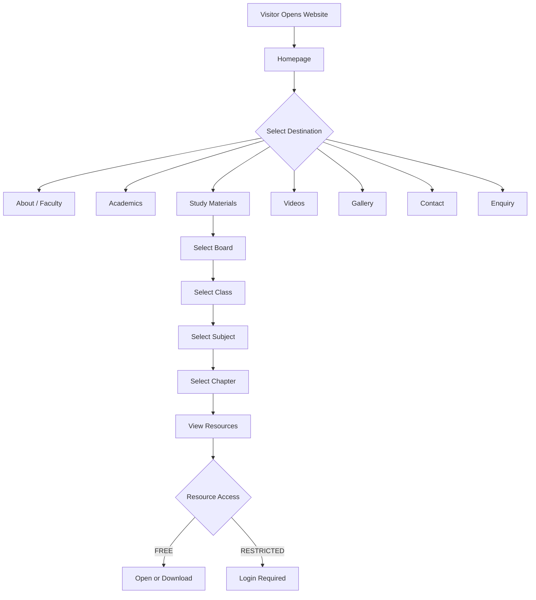
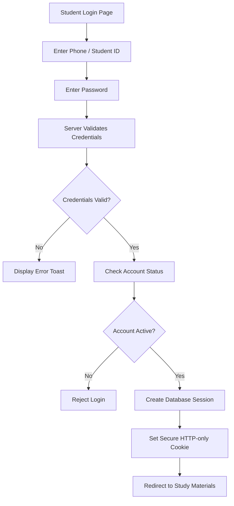
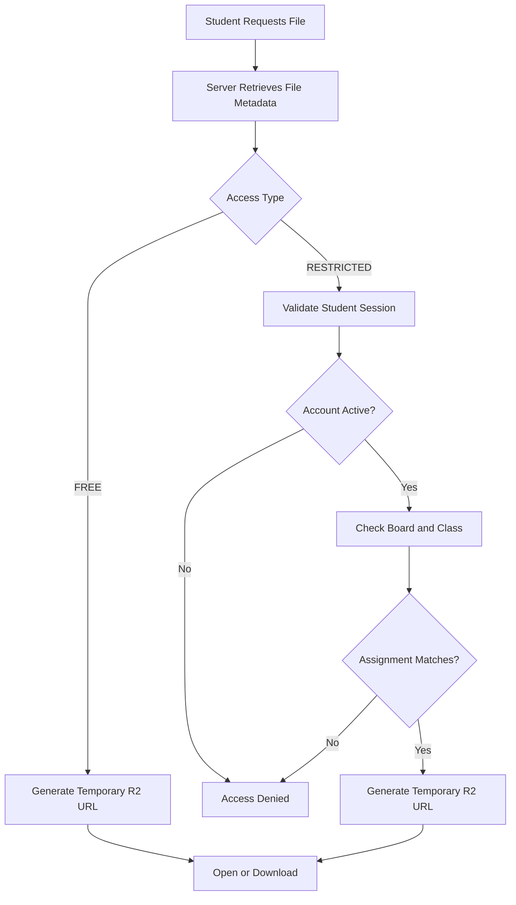
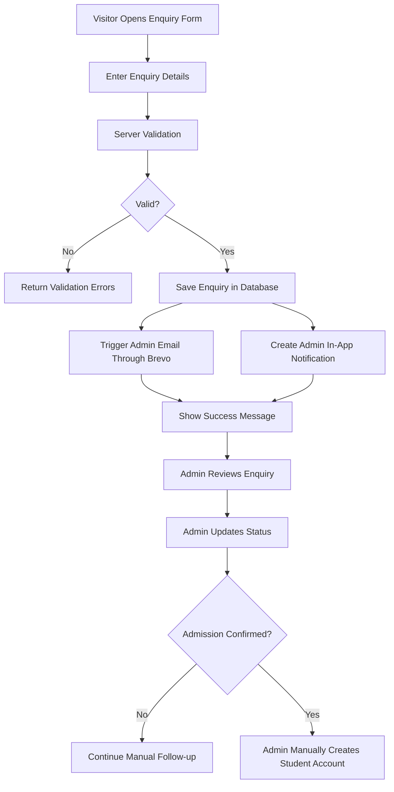
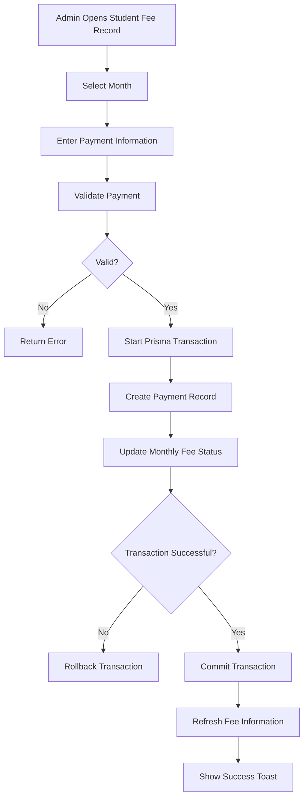
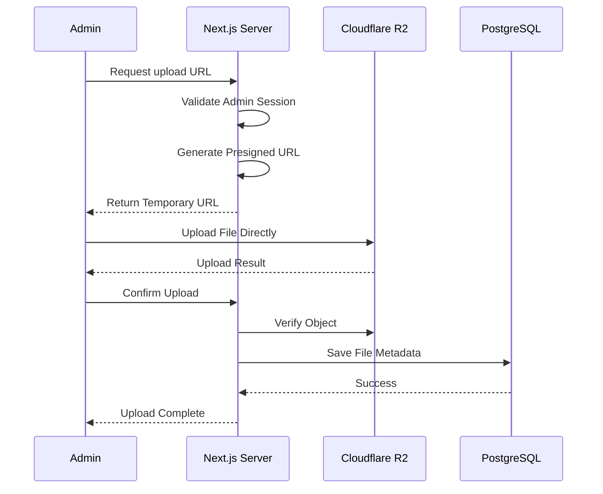
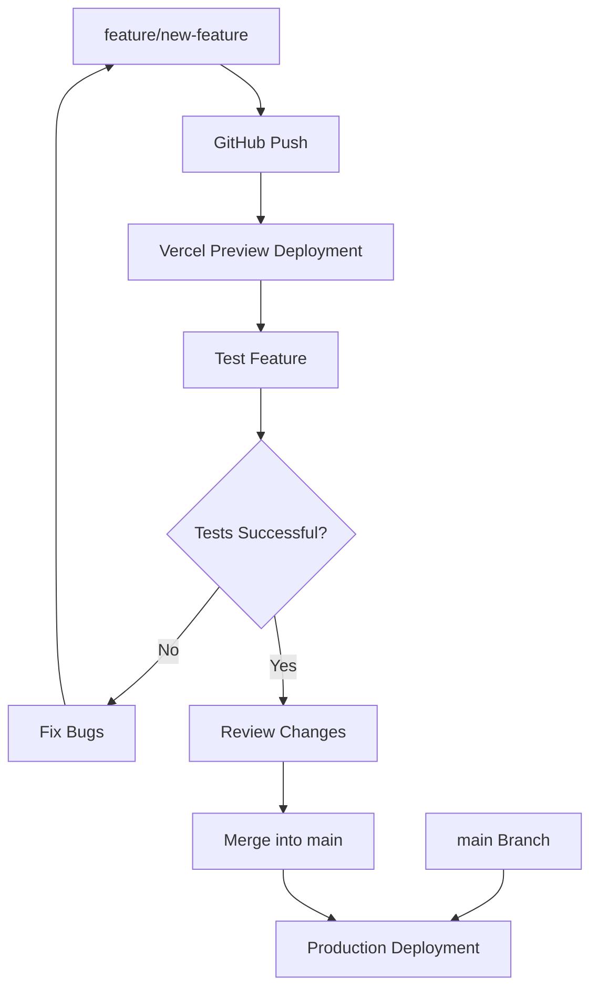

# A2Smart Classes — Application Architecture

**Document:** `ARCHITECTURE.md`  
**Project:** A2Smart Classes  
**Architecture:** Modular Monolith  
**Framework:** Next.js App Router  
**Language:** TypeScript  
**Version:** 1.0

---

# 1. Project Overview

A2Smart Classes is an educational academy management platform consisting of three integrated experiences:

1. **Public Website** — Provides information about the academy, courses, faculty, study materials, videos, gallery and enquiry submission.
2. **Student Experience** — Allows authenticated students to access their academic information, study materials, profiles and fee records.
3. **Super Admin Portal** — Allows the academy administrator to manage students, teachers, academics, study materials, videos, gallery, enquiries and fees.

All three experiences will operate through a single Next.js application and a single domain.

The application will follow a **Modular Monolith Architecture**, where different application features are organized into independent modules within one codebase.

## 1.1 Architectural Objectives

- Maintain a single, manageable codebase.
- Keep frontend and backend logic within one Next.js application.
- Separate application features through modular organization.
- Maintain strict authentication and authorization.
- Protect restricted educational resources.
- Preserve student academic and financial history.
- Keep database operations consistent.
- Minimize infrastructure and operational costs.
- Support future feature expansion without requiring a complete architectural redesign.

# 2. Technology Stack

## 2.1 Frontend

| Technology | Responsibility |
|---|---|
| Next.js | Application framework |
| React | UI development |
| TypeScript | Type safety |
| Tailwind CSS | Styling |
| shadcn/ui | Reusable UI components |
| Lucide React | Icons |
| Zustand | Shared client-side state |
| React State | Local component state |
| React Hook Form | Form management |
| Zod | Form and server-side validation |
| Sonner | Toast notifications |
| Next.js Image | Responsive image rendering |

## 2.2 Backend

| Technology | Responsibility |
|---|---|
| Next.js Route Handlers | Backend API endpoints |
| Next.js Server Actions | Server-side mutations |
| Next.js Server Components | Server-side rendering and data fetching |
| Prisma ORM | Database access and schema management |
| Zod | Server-side input validation |
| Node.js runtime | Server-side execution |

## 2.3 Database and Storage

| Technology | Responsibility |
|---|---|
| Supabase PostgreSQL | Primary relational database |
| Prisma ORM | Database queries and migrations |
| Cloudflare R2 | File and image storage |
| Presigned URLs | Secure direct file uploads and downloads |

## 2.4 Authentication and Communication

| Technology | Responsibility |
|---|---|
| Custom Authentication | Student and Super Admin authentication |
| Database-backed sessions | Session management |
| HTTP-only cookies | Secure session token storage |
| Brevo | OTP and transactional email delivery |

## 2.5 Deployment and Development

| Technology | Responsibility |
|---|---|
| Vercel | Application hosting |
| Git | Version control |
| GitHub | Source code repository |
| GitHub Actions | Automated development workflows where configured |
| OpenAI Codex | AI-assisted development |
| Vercel Cron | Scheduled background tasks |
| Sentry | Application error monitoring |
| Structured Logging | Server-side operational logs |

## 2.6 Testing

| Technology | Responsibility |
|---|---|
| Vitest | Unit testing |
| Integration Testing | Database, authentication and API testing |
| Playwright | End-to-end testing |

# 3. High-Level System Architecture

The application will follow a modular monolithic architecture.

The frontend, backend APIs, business logic, database access and authentication will remain within one Next.js application.

External services will handle database hosting, file storage, email delivery and application hosting.

## 3.1 Architecture Diagram



## 3.2 Architectural Layers

The application will have the following logical layers.

### Presentation Layer

Responsible for:

- Public website pages.
- Student pages.
- Admin pages.
- Reusable UI components.
- Forms and interactions.
- Loading and error states.
- Toast notifications.

### API Layer

Responsible for:

- Receiving requests.
- Validating incoming data.
- Checking authentication and permissions.
- Calling appropriate application services.
- Returning standardized responses.

### Service Layer

Responsible for:

- Application business logic.
- Business-rule enforcement.
- Multi-step operations.
- Authorization checks related to resources.
- Coordinating database and external service operations.

### Repository Layer

Responsible for:

- Prisma database queries.
- Database mutations.
- Data retrieval.
- Database-level filtering and relationships.

### Infrastructure Layer

Responsible for:

- Prisma configuration.
- Database connections.
- Cloudflare R2 integration.
- Brevo integration.
- Session management.
- Logging and monitoring.

# 4. Application Routing Architecture

The application will use the Next.js App Router.

All experiences will use one domain.

Example domain:

`https://yourdomain.com`

## 4.1 Public Website Routes

| Route | Purpose |
|---|---|
| `/` | Homepage |
| `/about` | About the academy |
| `/academics` | Courses and academic structure |
| `/academics/[board]/[class]` | Class-specific courses |
| `/faculty` | Faculty information |
| `/study-materials` | Study material hierarchy |
| `/videos` | Educational videos |
| `/gallery` | Gallery |
| `/contact` | Contact information |
| `/enquiry` | Enquiry submission |
| `/privacy-policy` | Privacy Policy |
| `/disclaimer` | Disclaimer |

## 4.2 Student Routes

| Route | Purpose |
|---|---|
| `/student/login` | Student login |
| `/student/forgot-password` | Password recovery |
| `/student/change-password` | Password change |
| `/profile` | Student profile |
| `/fees` | Student fee records |

The student experience will remain integrated into the public website.

After successful login, students will be redirected to:

`/study-materials`

## 4.3 Admin Routes

| Route | Purpose |
|---|---|
| `/admin/login` | Super Admin login |
| `/admin/dashboard` | Admin dashboard |
| `/admin/students` | Student management |
| `/admin/teachers` | Teacher management |
| `/admin/academics` | Academic structure management |
| `/admin/materials` | Study material management |
| `/admin/videos` | Video management |
| `/admin/enquiries` | Enquiry management |
| `/admin/gallery` | Gallery management |
| `/admin/fees` | Fee management |

The admin portal will have its own layout and navigation.

No public website footer will be displayed inside the admin portal.

## 4.4 Special Application Pages

### Custom 404 Page

A custom 404 page will be implemented using the App Router's `not-found.tsx`.

Location:

`src/app/not-found.tsx`

Requirements:

- Display a clear 404 Page Not Found message.
- Follow the A2Smart Classes visual theme.
- Include a Go to Homepage action.
- Work responsively on mobile and desktop.
- Handle invalid routes gracefully.

### Error and Loading Pages

Use Next.js error and loading boundaries where appropriate.

Examples:

- `loading.tsx`
- `error.tsx`
- `global-error.tsx`
- `not-found.tsx`

These files will be introduced at the appropriate route-group or application level.

# 5. Application Flow

## 5.1 Public Visitor Flow



## 5.2 Student Login Flow



## 5.3 Student Access to Restricted Materials



All restricted file authorization will happen on the server.

The frontend will never be responsible for deciding whether a student is authorized.

## 5.4 Enquiry Flow



No student account will be automatically created when an enquiry is submitted.

No enquiry confirmation email will be sent to the student.

## 5.5 Fee Payment Flow



Fee calculations and payment rules will be enforced in the service layer.

# 6. Authentication Architecture

A shared custom authentication system will serve both Students and the Super Admin.

## 6.1 Account Roles

Version 1 will support:

- `STUDENT`
- `SUPER_ADMIN`

Only one Super Admin account will exist in Version 1.

No public admin registration will be available.

Teacher accounts will not be supported in Version 1.

## 6.2 Authentication Responsibilities

The authentication module will manage:

- Login.
- Logout.
- Password hashing and verification.
- Session creation.
- Session validation.
- Session expiration.
- Session revocation.
- Forgot password.
- OTP verification.
- Password changes.
- Role-based authorization.

## 6.3 Database-Backed Sessions

Database-backed sessions will be used instead of JWT-based authentication.

### Session Creation

1. User submits login credentials.
2. Server verifies the credentials.
3. Server generates a cryptographically secure random session token.
4. The token is hashed.
5. Only the hashed token is stored in PostgreSQL.
6. The original token is stored in an HTTP-only cookie.

### Cookie Configuration

The session cookie should use:

- `HttpOnly`
- `Secure` in production
- `SameSite=Lax` or an appropriately restrictive setting
- An appropriate expiration
- A restricted cookie path where applicable

### Session Expiration

Sliding session expiration will be implemented.

When the user remains active, the session expiration can be extended.

An absolute maximum lifetime should also be enforced.

### Logout

1. User selects Logout.
2. Confirmation is displayed.
3. Server revokes the current session.
4. Authentication cookie is cleared.
5. User is redirected to the appropriate login page.

Protected pages must remain inaccessible after logout, including when the user navigates backwards through browser history.

## 6.4 Student Authorization

Every protected student operation must validate:

- Session validity.
- Student account status.
- Student role.
- Resource-level authorization where required.

Inactive students must not access restricted study materials or protected student information.

## 6.5 Super Admin Authorization

Super Admin operations must verify the administrator's authenticated session and role.

Admin authorization must be enforced on the server.

## 6.6 Password Management

Student temporary passwords will be generated using:

`<FirstName><BirthYear>`

Example:

`Rahul2008`

Students will be advised to change their temporary password.

A mandatory first-login password change will NOT be enforced.

Students can decide whether and when to change their password.

Passwords must be securely hashed and never stored as plaintext.

## 6.7 OTP Architecture

Forgot-password OTP verification will use:

- Random four-digit OTP.
- Five-minute validity.
- Thirty-second resend cooldown.
- New OTP invalidates the previous OTP.
- Incorrect-attempt limits.
- One-time OTP usage.
- Server-side verification.
- Secure storage using OTP hashes.

OTP emails will be delivered through Brevo.

# 7. Database Architecture

## 7.1 Database Technology

Primary database:

**Supabase PostgreSQL**

ORM:

**Prisma**

The application will use a relational database structure.

All Prisma models will be maintained in a single schema file.

```text
prisma/
├── schema.prisma
└── migrations/
```

## 7.2 Database Domains

The database will be organized into the following domains.

### Authentication

Responsible for:

- Student and Super Admin accounts.
- Session records.
- OTP verification records.
- Password-related information.

### Students

Responsible for:

- Student profiles.
- Student IDs.
- Academic assignments.
- Admission information.
- Account status.

### Academics

Responsible for:

- Boards.
- Classes.
- Subjects.
- Chapters.
- Academic sessions.

### Teachers

Responsible for:

- Teacher profiles.
- Qualifications.
- Subjects taught.
- Teaching experience.
- Profile photographs.

### Study Materials

Responsible for:

- Resource categories.
- Study material records.
- File metadata.
- FREE and RESTRICTED access status.
- File ordering.

### Videos

Responsible for:

- YouTube playlists.
- Playlist titles.
- Playlist URLs.
- Academic assignments.

### Gallery

Responsible for:

- Gallery image metadata.
- Image captions.
- R2 object references.

### Enquiries

Responsible for:

- Enquiry submissions.
- Enquiry statuses.
- Internal notes.

### Fees

Responsible for:

- Monthly fee records.
- Payment transactions.
- Payment methods.
- Outstanding amounts.
- Academic-year fee information.

## 7.3 Database Relationships

The database will use appropriate:

- Primary keys.
- Foreign keys.
- Unique constraints.
- Required-field constraints.
- Indexes.
- Relational mappings.

Important relationships include:

```text
Board
  └── Class
       └── Subject
            └── Chapter
                 └── Resource Categories
                      └── Study Materials

Student
  ├── Board
  ├── Class
  ├── Academic Session
  ├── Enrolled Subjects
  └── Fee Records
       └── Payment Transactions

Teacher
  ├── Qualifications
  └── Subjects Taught

Enquiry
  └── Enquiry Status and Internal Note
```

The exact Prisma models and constraints will be defined during database implementation.

## 7.4 Prisma Connection Strategy

Two connection URLs will be configured:

- `DATABASE_URL` — pooled Supabase connection for normal application queries.
- `DIRECT_URL` — direct database connection for migrations and administrative database operations.

The exact Prisma configuration will follow the selected Prisma version.

## 7.5 Database Transactions

Prisma `$transaction` will be used for operations involving multiple related database changes.

Examples:

- Student creation.
- Fee payment recording.
- Related academic updates.
- Other multi-record operations requiring consistency.

If a transaction fails, its database changes must roll back.

## 7.6 Deletion and Historical Data Protection

The application will follow dependency protection.

- Student deletion will be soft deletion.
- Enquiries cannot be deleted.
- Fee payment history must be preserved.
- Academic records must not be accidentally deleted.
- Parent records with dependencies cannot be deleted until dependencies are resolved.
- Deactivation will be used where appropriate.
- Permanent deletion will be used only where already specified, such as study materials and gallery images.

A general administrative audit-log system will not be introduced in Version 1.

# 8. Database Migration Architecture

Prisma migrations will maintain database structure changes.

### Development

Use:

```bash
npx prisma migrate dev
```

This creates and applies migrations in the development database.

### Production

Use:

```bash
npx prisma migrate deploy
```

Production migrations will require deliberate manual approval initially.

### Production Migration Workflow

1. Modify Prisma schema.
2. Generate the migration locally.
3. Review the migration SQL.
4. Test the migration locally.
5. Verify the application functionality.
6. Prepare the production release.
7. Obtain explicit approval.
8. Apply the migration to production.
9. Verify the deployment.

Production migrations must never be applied blindly.

Destructive database changes require particular care.

Avoid running `prisma migrate reset` against production.

# 9. File Storage Architecture

## 9.1 Storage Provider

All uploaded files and images will be stored in:

**Cloudflare R2**

The R2 bucket will remain private.

Study materials and gallery images will not be stored directly in the PostgreSQL database.

Only file metadata and object references will be stored in PostgreSQL.

## 9.2 File Upload Architecture

The application will use presigned URL uploads.



## 9.3 Upload Security

The server must:

- Verify Super Admin authentication.
- Validate permitted file types.
- Validate file size.
- Generate temporary upload URLs.
- Restrict upload permissions.
- Verify uploaded objects before saving metadata.
- Prevent unauthorized uploads.

The browser must never receive permanent R2 secret access credentials.

## 9.4 File Access Architecture

R2 will use a private bucket with temporary presigned download URLs.

For FREE materials:

- No login is required.
- The server verifies that the resource is FREE.
- A temporary access URL is generated.

For RESTRICTED materials:

- Student login is required.
- Student account must be active.
- Student board must match.
- Student class must match.
- Only then is a temporary access URL generated.

Unauthorized users must never receive restricted file URLs.

## 9.5 File Replacement

File replacement will follow a safe workflow:

1. Upload the replacement file.
2. Verify successful upload.
3. Update the database record.
4. Delete the previous R2 object.

If the new upload fails, the existing file must remain available.

## 9.6 File Deletion

Study material and gallery deletion will remove:

- The database record.
- The corresponding R2 object.

Permanent deletion must require appropriate confirmation.

## 9.7 PDF and DOCX Handling

PDF:

- Open on a separate viewing page.
- Show filename and academic context.
- Display embedded browser-native PDF viewer.
- Provide Download PDF action.

DOCX:

- Direct download.
- No separate preview page.

# 10. Image Architecture

Images will be stored in Cloudflare R2.

Next.js Image will be used for responsive image rendering and optimization.

Image sources will include:

- Homepage slideshow.
- Faculty photographs.
- Institute photographs.
- Gallery images.
- Subject photographs.

The Next.js image configuration must allow the approved image delivery domain.

Image optimization usage and Vercel limits should be reviewed before production deployment.

# 11. Email Architecture

## 11.1 Email Provider

Transactional emails will use:

**Brevo**

All emails will be sent through a centralized server-side email service.

```text
Next.js Server
      |
      v
Email Service
      |
      v
Brevo API
      |
      v
Recipient Inbox
```

## 11.2 Email Responsibilities

- Student password recovery OTP.
- Super Admin password recovery OTP.
- New enquiry notification to Super Admin.

No student enquiry confirmation email will be sent.

## 11.3 Email Security

- Brevo API credentials remain server-side.
- No secret keys in frontend code.
- Email failures must be handled appropriately.
- Email delivery must not expose sensitive authentication information.

No separate background email queue will be introduced in Version 1.

# 12. Frontend State Management

The application will use Zustand alongside React's native state management.

## 12.1 Zustand

Used for shared client-side state where necessary.

Examples:

- Authenticated user information.
- Shared UI state.
- State that needs to be accessed by multiple components.

## 12.2 React State

Use `useState` and `useReducer` for:

- Local component interactions.
- Dropdowns.
- Modals.
- Form interactions.
- Temporary filters.
- Local UI state.

## 12.3 Server Components

Next.js Server Components will handle server-side data fetching wherever possible.

Sensitive information and authorization decisions must remain server-side.

Zustand must never be treated as the authority for authentication or permissions.

# 13. Form Validation Architecture

The application will use:

- Zod.
- React Hook Form.

Zod will define reusable validation schemas.

React Hook Form will manage form state and client-side validation.

The same Zod schemas will be reused on the server where appropriate.

All important input data must be validated again on the server.

# 14. API Architecture

## 14.1 API Organization

Backend API endpoints will be organized by feature.

Example:

```text
/api/auth
/api/students
/api/teachers
/api/academics
/api/materials
/api/videos
/api/gallery
/api/enquiries
/api/fees
```

Additional endpoints may be introduced where required by the approved application functionality.

## 14.2 API Responsibilities

Each API endpoint must:

1. Receive the request.
2. Validate the request.
3. Verify authentication where required.
4. Verify authorization.
5. Call the appropriate service.
6. Return a standardized response.

## 14.3 Standard API Response

Successful response:

```json
{
  "success": true,
  "data": {},
  "message": "Operation successful"
}
```

Error response:

```json
{
  "success": false,
  "error": {
    "code": "VALIDATION_ERROR",
    "message": "Invalid input"
  }
}
```

Use appropriate HTTP status codes.

Internal stack traces, database errors and secret information must never be exposed to users.

# 15. Service and Repository Architecture

The application will use the Service + Repository pattern.

Example:

```text
features/
└── fees/
    ├── components/
    ├── schemas/
    ├── services/
    └── repositories/
```

## 15.1 Repository

Responsible for database access.

Example:

`fee.repository.ts`

Responsibilities:

- Retrieve fee records.
- Create payment records.
- Update monthly fee information.
- Retrieve student payment history.

## 15.2 Service

Responsible for business rules.

Example:

`fee.service.ts`

Responsibilities:

- Validate payment operations.
- Enforce monthly payment rules.
- Calculate outstanding fees.
- Coordinate database transactions.
- Ensure payment records are handled consistently.

## 15.3 Route Handlers and Server Actions

They will call the service layer rather than directly implementing complex business logic.

# 16. Toast Notification Architecture

A global toast notification system will be implemented using:

**Sonner**

It will be available throughout:

- Public website.
- Student experience.
- Super Admin portal.

## 16.1 Toast Types

| Type | Purpose |
|---|---|
| Success | Successful operations |
| Error | Failed operations |
| Warning | Important caution or validation |
| Info | Informational updates |

## 16.2 Example Notifications

| Action | Notification |
|---|---|
| Student login | Logged in successfully! |
| Admin login | Welcome back, Admin! |
| Logout | Logged out successfully. |
| Student creation | Student added successfully! |
| Student update | Student details updated successfully! |
| Student deactivation | Student deactivated successfully! |
| Student reactivation | Student account reactivated! |
| Teacher creation | Teacher added successfully! |
| Material upload | Study material uploaded successfully! |
| Material replacement | Study material replaced successfully! |
| Material deletion | Study material deleted successfully! |
| Gallery upload | Image uploaded successfully! |
| Gallery deletion | Image deleted successfully! |
| Enquiry submission | Enquiry submitted successfully! |
| Enquiry update | Enquiry status updated successfully! |
| Fee recording | Payment recorded successfully! |
| Password change | Password changed successfully! |

All operations must display meaningful error messages when they fail.

## 16.3 Notification Rules

- Show success only after the server confirms success.
- Avoid duplicate notifications.
- Use consistent styling and positioning.
- Support mobile and desktop.
- Ensure accessible notifications.
- Use confirmation dialogs for destructive actions instead of relying only on toasts.

# 17. Caching Architecture

The application will use selective caching with revalidation.

## 17.1 Public Content

Appropriate public content may be cached:

- Faculty information.
- Courses.
- Academic structure.
- Videos.
- Gallery.

## 17.2 Cache Revalidation

After successful admin updates, the affected content will be revalidated using Next.js mechanisms such as:

- `revalidatePath`
- `revalidateTag`

## 17.3 Dynamic Data

The following data must be fetched dynamically where appropriate:

- Student profiles.
- Student fee records.
- Authentication sessions.
- Restricted resource authorization.
- Student-specific academic information.

Authentication and authorization decisions must never depend on stale cached results.

# 18. Security Architecture

Security must be enforced at the server level.

## 18.1 Authentication Security

- Secure password hashing.
- Database-backed sessions.
- HTTP-only cookies.
- Session revocation.
- Session expiration.
- OTP expiration and attempt limits.

## 18.2 Authorization Security

- Role-based access control.
- Student account status verification.
- Board/class-based material authorization.
- Super Admin-only management operations.
- Server-side permission checks.

## 18.3 File Security

- Private R2 buckets.
- Presigned upload URLs.
- Temporary download URLs.
- File-type validation.
- File-size validation.
- Server-side upload authorization.

## 18.4 API Security

- Server-side validation.
- Appropriate authorization.
- Rate limiting.
- Safe error responses.
- Protection against unauthorized requests.

## 18.5 Secret Management

Sensitive credentials must be stored in environment variables.

Never expose:

- Database credentials.
- R2 secret access keys.
- Brevo API keys.
- Session secrets.
- Password hashes.
- OTP hashes.

Secret values must never be committed to GitHub.

## 18.6 Rate Limiting

Cloudflare edge-level protection will be used where supported by the selected plan.

Application-level protections will also enforce relevant login and OTP rules.

Cloudflare rate limiting does not replace application-level authentication controls.

# 19. Background Jobs and Scheduled Tasks

Vercel Cron Jobs will be used for scheduled tasks where necessary.

Potential responsibilities based on existing requirements:

- Cleanup of expired OTP records.
- Cleanup of expired or revoked sessions.
- Periodic database housekeeping where needed.

Cron endpoints must be protected against unauthorized invocation.

Security checks for OTP and session expiration must still happen during normal requests.

Cron cleanup must not be the only mechanism enforcing expiry.

Availability and execution limits must be checked against the selected Vercel plan.

# 20. Error Monitoring and Logging

The application will use:

**Sentry + Structured Server Logs**

## 20.1 Sentry

Responsible for:

- Capturing application exceptions.
- Tracking runtime errors.
- Providing debugging information.
- Separating development and production error reports.

## 20.2 Structured Logs

Server-side logs will record relevant operational information.

Sensitive information must not be logged.

Never log:

- Passwords.
- OTPs.
- Session tokens.
- Secret credentials.
- Unnecessary student personal information.

# 21. Testing Architecture

Testing will use three levels.

## 21.1 Unit Testing

Tool: Vitest

Test:

- Individual service functions.
- Validation schemas.
- Business rules.
- Fee calculations.
- Utility functions.

## 21.2 Integration Testing

Test:

- Prisma repository operations.
- Database relationships.
- Authentication.
- Authorization.
- API workflows.
- Database transactions.

## 21.3 End-to-End Testing

Tool: Playwright

Test important user journeys:

- Student login.
- Admin login.
- Student profile access.
- Restricted study material authorization.
- FREE material access.
- Enquiry submission.
- Student creation and deactivation.
- Fee payment recording.
- Logout.
- Password recovery.

# 22. Deployment Architecture

## 22.1 Hosting

Application hosting:

**Vercel**

Source repository:

**GitHub**

Production database:

**Supabase PostgreSQL**

File storage:

**Cloudflare R2**

Transactional email:

**Brevo**

## 22.2 Domain Architecture

A single domain will be used.

Example:

```text
yourdomain.com/
yourdomain.com/student/login
yourdomain.com/profile
yourdomain.com/fees
yourdomain.com/admin/login
yourdomain.com/admin/students
```

No separate student or admin subdomains will be introduced.

## 22.3 Root Configuration: vercel.json

A `vercel.json` file must be included in the project root.

Its responsibilities will include any required Vercel-specific configuration, such as:

- Deployment-related settings.
- Cron job declarations where configured.
- Necessary routing or rewrite configuration only if required.

Next.js App Router routes will work natively, so unnecessary rewrites must not be introduced.

The file must be maintained alongside the rest of the project configuration.

# 23. Development and Production Environments

Version 1 will use two permanent environments.

## 23.1 Development

- Local Next.js application.
- Development Supabase project.
- Development R2 bucket.
- Development environment variables.
- Dummy student and fee data.

Local URL:

`http://localhost:3000`

## 23.2 Production

- Vercel production deployment.
- Production Supabase project.
- Production R2 bucket.
- Production environment variables.
- Real academy and student data.

## 23.3 Testing Through Vercel Preview Deployments

A separate permanent staging environment and database will not be introduced in Version 1.

Instead, Vercel Preview Deployments will be used for testing feature branches.

Workflow:



Preview deployments must use safe test configuration and must never accidentally connect to or modify production data.

When testing database changes, use the development database or another explicitly configured non-production test database.

A permanent staging database is not required for Version 1.

# 24. Environment Variables

Environment variables will be maintained separately for local development and production.

Example `.env.example`:

```env
# Application
NODE_ENV=
NEXT_PUBLIC_APP_URL=

# Database
DATABASE_URL=
DIRECT_URL=

# Authentication
SESSION_SECRET=

# Cloudflare R2
R2_ACCOUNT_ID=
R2_ACCESS_KEY_ID=
R2_SECRET_ACCESS_KEY=
R2_BUCKET_NAME=
R2_PUBLIC_BASE_URL=

# Brevo
BREVO_API_KEY=
BREVO_SENDER_EMAIL=

# Sentry
SENTRY_DSN=
```

Additional variables may be added when required by implementation.

`R2_PUBLIC_BASE_URL` must only be used if a configured image-delivery URL is intentionally available. Restricted study materials must not be made publicly accessible through this setting.

The `.env.example` file must contain placeholder values only.

Actual `.env` files must be excluded from Git.

Production and development credentials must never be shared.

# 25. Git and Version Control Architecture

One GitHub repository will be used.

Suggested branches:

```text
main
feature/*
fix/*
```

`main` represents the production-ready application.

Feature branches will be used for:

- New functionality.
- Improvements.
- Bug fixes.
- Experimental changes.

Feature branches can be pushed to GitHub to trigger Vercel Preview deployments.

After testing and approval, changes can be merged into `main`.

GitHub Actions will be used for configured automated development workflows, such as running checks and tests.

# 26. Backup and Recovery

Supabase managed backups will be used initially.

The project will:

- Use Supabase backup facilities available on the selected plan.
- Document database restoration procedures.
- Verify backup frequency and retention.
- Restrict access to backup operations.

Important:

Supabase PostgreSQL backups do not automatically back up Cloudflare R2 objects.

R2 file protection and recovery must be handled separately.

# 27. Complete Project Folder Structure

The following is the proposed folder structure for A2Smart Classes.

It follows the feature-based modular architecture and Service + Repository pattern.

```text
a2smart-classes/
│
├── public/
│   ├── images/
│   ├── icons/
│   ├── fonts/
│   └── favicon.ico
│
├── prisma/
│   ├── schema.prisma
│   └── migrations/
│
├── src/
│   │
│   ├── app/
│   │   │
│   │   ├── (public)/
│   │   │   ├── layout.tsx
│   │   │   ├── page.tsx
│   │   │   ├── about/
│   │   │   │   └── page.tsx
│   │   │   ├── academics/
│   │   │   │   ├── page.tsx
│   │   │   │   └── [board]/
│   │   │   │       └── [class]/
│   │   │   │           └── page.tsx
│   │   │   ├── faculty/
│   │   │   │   └── page.tsx
│   │   │   ├── study-materials/
│   │   │   │   ├── page.tsx
│   │   │   │   ├── [board]/
│   │   │   │   │   └── [class]/
│   │   │   │   │       └── page.tsx
│   │   │   │   └── [board]/
│   │   │   │       └── [class]/
│   │   │   │           └── [subject]/
│   │   │   │               └── [chapter]/
│   │   │   │                   └── page.tsx
│   │   │   ├── videos/
│   │   │   │   └── page.tsx
│   │   │   ├── gallery/
│   │   │   │   └── page.tsx
│   │   │   ├── contact/
│   │   │   │   └── page.tsx
│   │   │   ├── enquiry/
│   │   │   │   └── page.tsx
│   │   │   ├── privacy-policy/
│   │   │   │   └── page.tsx
│   │   │   └── disclaimer/
│   │   │       └── page.tsx
│   │   │
│   │   ├── (student)/
│   │   │   ├── layout.tsx
│   │   │   ├── student/
│   │   │   │   ├── login/
│   │   │   │   │   └── page.tsx
│   │   │   │   ├── forgot-password/
│   │   │   │   │   └── page.tsx
│   │   │   │   └── change-password/
│   │   │   │       └── page.tsx
│   │   │   ├── profile/
│   │   │   │   └── page.tsx
│   │   │   └── fees/
│   │   │       └── page.tsx
│   │   │
│   │   ├── admin/
│   │   │   ├── layout.tsx
│   │   │   ├── login/
│   │   │   │   └── page.tsx
│   │   │   ├── dashboard/
│   │   │   │   └── page.tsx
│   │   │   ├── students/
│   │   │   │   └── page.tsx
│   │   │   ├── teachers/
│   │   │   │   └── page.tsx
│   │   │   ├── academics/
│   │   │   │   └── page.tsx
│   │   │   ├── materials/
│   │   │   │   └── page.tsx
│   │   │   ├── videos/
│   │   │   │   └── page.tsx
│   │   │   ├── enquiries/
│   │   │   │   └── page.tsx
│   │   │   ├── gallery/
│   │   │   │   └── page.tsx
│   │   │   └── fees/
│   │   │       └── page.tsx
│   │   │
│   │   ├── api/
│   │   │   ├── auth/
│   │   │   ├── students/
│   │   │   ├── teachers/
│   │   │   ├── academics/
│   │   │   ├── materials/
│   │   │   ├── videos/
│   │   │   ├── gallery/
│   │   │   ├── enquiries/
│   │   │   └── fees/
│   │   │
│   │   ├── not-found.tsx
│   │   ├── error.tsx
│   │   ├── global-error.tsx
│   │   ├── loading.tsx
│   │   └── layout.tsx
│   │
│   ├── components/
│   │   ├── ui/
│   │   ├── shared/
│   │   ├── layout/
│   │   ├── forms/
│   │   └── providers/
│   │
│   ├── features/
│   │   ├── auth/
│   │   │   ├── components/
│   │   │   ├── schemas/
│   │   │   ├── services/
│   │   │   └── repositories/
│   │   │
│   │   ├── students/
│   │   │   ├── components/
│   │   │   ├── schemas/
│   │   │   ├── services/
│   │   │   └── repositories/
│   │   │
│   │   ├── teachers/
│   │   ├── academics/
│   │   ├── materials/
│   │   ├── videos/
│   │   ├── gallery/
│   │   ├── enquiries/
│   │   └── fees/
│   │
│   ├── lib/
│   │   ├── prisma.ts
│   │   ├── auth.ts
│   │   ├── session.ts
│   │   ├── permissions.ts
│   │   ├── r2.ts
│   │   ├── brevo.ts
│   │   ├── email.ts
│   │   ├── api-response.ts
│   │   ├── logger.ts
│   │   ├── rate-limit.ts
│   │   ├── constants.ts
│   │   └── utils.ts
│   │
│   ├── hooks/
│   │
│   ├── stores/
│   │   └── auth-store.ts
│   │
│   ├── types/
│   │
│   └── styles/
│       └── globals.css
│
├── tests/
│   ├── unit/
│   ├── integration/
│   └── e2e/
│
├── .github/
│   └── workflows/
│
├── .env.example
├── .gitignore
├── components.json
├── eslint.config.mjs
├── next.config.ts
├── package.json
├── package-lock.json
├── postcss.config.mjs
├── prisma.config.ts
├── tsconfig.json
├── vercel.json
├── vitest.config.ts
├── playwright.config.ts
└── README.md
```

## 27.1 Folder Responsibilities

### `src/app/`

Contains:

- Next.js routes.
- Page components.
- Layouts.
- Route Handlers.
- Error boundaries.
- Loading states.
- 404 page.

Route files should primarily compose feature components and coordinate page-level data fetching.

### `src/features/`

Contains independent application feature modules.

Each feature may include:

- `components/` — Feature-specific UI.
- `schemas/` — Zod validation schemas.
- `services/` — Business logic.
- `repositories/` — Prisma database operations.

### `src/components/`

Contains reusable components shared across features.

Examples:

- Buttons.
- Dialogs.
- Tables.
- Input components.
- Navigation.
- Header.
- Footer.
- Shared layouts.

### `src/lib/`

Contains shared infrastructure and utility configuration.

Examples:

- Prisma client.
- Authentication helpers.
- Session utilities.
- R2 client.
- Brevo integration.
- API response helpers.
- Logger.
- Rate-limiting utilities.

### `src/stores/`

Contains Zustand stores for shared client-side state.

### `src/hooks/`

Contains reusable React hooks.

### `src/types/`

Contains shared TypeScript types.

### `prisma/`

Contains the database schema and migrations.

### `tests/`

Contains automated unit, integration and end-to-end tests.

### `public/`

Contains static assets that are part of the application.

### Root Configuration Files

| File | Responsibility |
|---|---|
| `vercel.json` | Vercel-specific deployment and routing configuration |
| `next.config.ts` | Next.js configuration |
| `prisma.config.ts` | Prisma configuration |
| `tsconfig.json` | TypeScript configuration |
| `package.json` | Dependencies and scripts |
| `components.json` | shadcn/ui configuration |
| `.env.example` | Environment variable template |
| `.gitignore` | Files excluded from Git |
| `vitest.config.ts` | Vitest configuration |
| `playwright.config.ts` | Playwright configuration |
| `eslint.config.mjs` | ESLint configuration |
| `README.md` | Project setup and documentation |

The structure is a proposed implementation layout. Directories can be created as their corresponding features are implemented rather than creating every empty folder immediately.

# 28. Important Architectural Rules

The following rules must be followed throughout development.

1. Maintain one Next.js application.
2. Use App Router.
3. Use TypeScript.
4. Follow feature-based modular organization.
5. Keep business logic in services.
6. Keep Prisma database operations in repositories.
7. Validate input on the server.
8. Enforce authentication and authorization on the server.
9. Never trust client-side role or permission state.
10. Never expose database credentials.
11. Never expose R2 secret credentials.
12. Never expose restricted file URLs to unauthorized users.
13. Use Prisma transactions for related database operations.
14. Protect historical academic and fee information.
15. Use Sonner for consistent toast notifications.
16. Use selective caching and appropriate revalidation.
17. Keep production and development configurations separate.
18. Test feature branches using Vercel Preview deployments.
19. Require manual approval for production database migrations.
20. Maintain `vercel.json` in the root directory.
21. Maintain a custom responsive 404 page.
22. Do not introduce additional infrastructure without a clear requirement.

# 29. Version 1 Infrastructure Summary

| Component | Selected Technology |
|---|---|
| Frontend | Next.js + React |
| Language | TypeScript |
| Routing | App Router |
| Styling | Tailwind CSS |
| UI Components | shadcn/ui |
| Icons | Lucide React |
| State Management | Zustand + React State |
| Forms | React Hook Form |
| Validation | Zod |
| Toast Notifications | Sonner |
| Backend | Next.js Route Handlers + Server Actions |
| Architecture | Modular Monolith |
| Data Access | Service + Repository |
| ORM | Prisma |
| Database | Supabase PostgreSQL |
| Authentication | Custom Authentication |
| Sessions | Database-backed sliding sessions |
| Authorization | Role-based access control |
| Storage | Cloudflare R2 |
| Uploads | Presigned URLs |
| Emails | Brevo |
| Hosting | Vercel |
| Scheduled Jobs | Vercel Cron |
| Monitoring | Sentry |
| Logging | Structured Server Logs |
| Unit Testing | Vitest |
| E2E Testing | Playwright |
| Version Control | Git + GitHub |
| Deployment Configuration | `vercel.json` |
| Development Assistance | OpenAI Codex |

# 30. Future Scalability

The initial architecture will prioritize simplicity and maintainability.

Future architectural changes should be introduced only when actual requirements justify them.

Potential future improvements may include:

- Dedicated staging infrastructure.
- More granular role-based permissions if additional account roles are introduced.
- Additional automated deployment checks.
- More advanced monitoring.
- Independent background workers if processing requirements increase.

These are not Version 1 implementation commitments.

---

# Final Architecture Decision

A2Smart Classes Version 1 will use a **single Next.js modular monolith application** with:

- Feature-based code organization.
- App Router.
- TypeScript.
- Zustand.
- Service + Repository pattern.
- Prisma ORM.
- Supabase PostgreSQL.
- Custom database-backed authentication.
- Cloudflare R2 private storage.
- Brevo transactional emails.
- Vercel hosting.
- Selective caching.
- Server-side security and authorization.
- Automated testing.
- Sentry monitoring.
- Sonner toast notifications.
- Manual approval for production database migrations.

The objective is to build a secure, maintainable and cost-conscious educational platform without introducing unnecessary infrastructure or architectural complexity.

**This document describes the agreed Version 1 application architecture.**